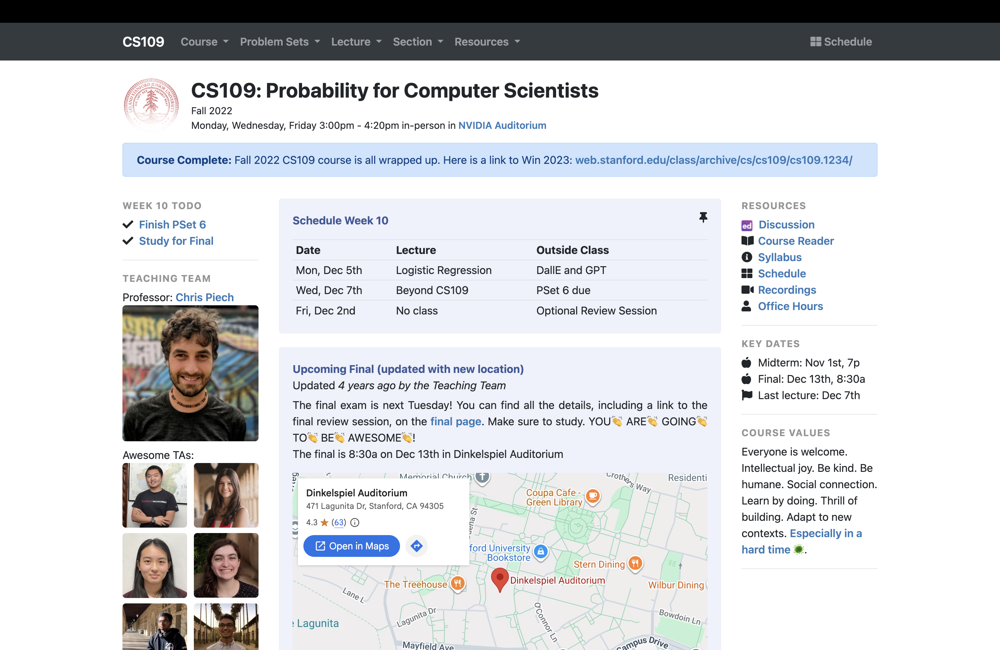
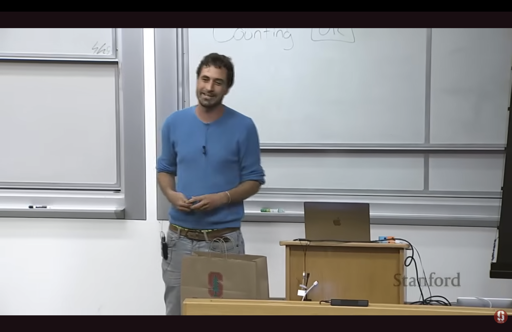
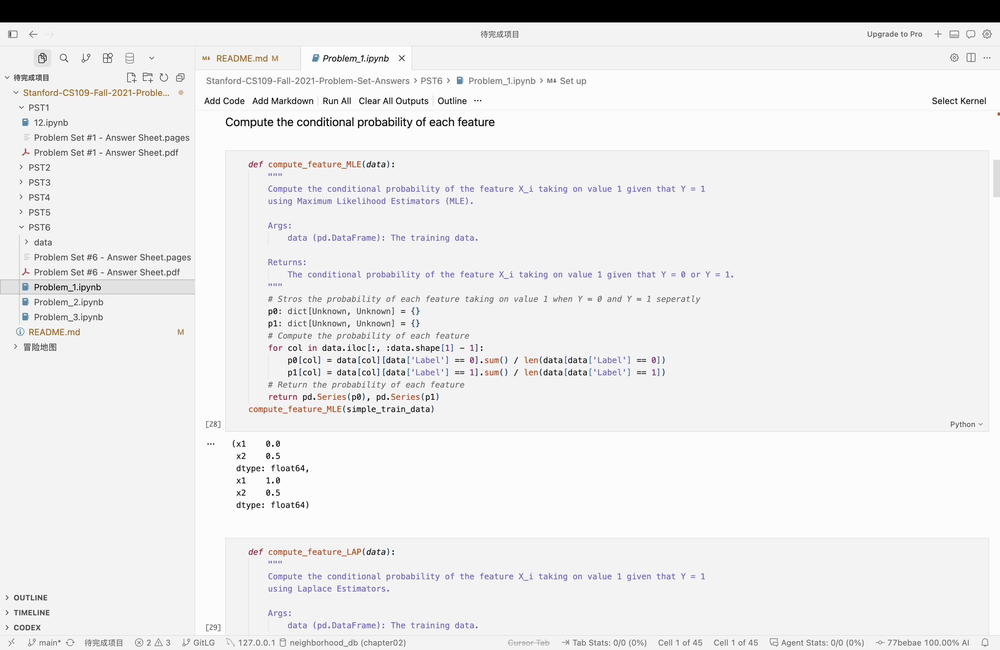

# 简介

这是 Stanford CS109 - Probability for Computer Scientists (Fall 2021) 课程的全部作业。

# 课程简介

课程包含了基础到中级的概率论知识，从 "Definition of Probability" 开始，逐步覆盖 Bayes‘ Therom、Random Variables、Expectation、Variance 等重要基础概念，慢慢扩展至 Bernoulli Distribution、Poisson Distribution、Normal Distribution 等重要概率模型，后续延伸至 Multinomial、Inference、Bayesian Networks 等高级概率模型，最后引入机器学习等基础算法如 Naive Bayes、Logistic Regression 等。

课程共有6次作业，每一次的作业都包含有使用概率论解决实际问题的题目，并附有编程题以将理论与编程相结合。

# 课程展示

| Homepage                              | Lecture                           | PST                              |
| ------------------------------------- | --------------------------------- | -------------------------------- |
|  |  |  |

# 课程信息

[课程主页](https://web.stanford.edu/class/archive/cs/cs109/cs109.1232/)
[讲座视频](https://youtube.com/playlist?list=PLoROMvodv4rOpr_A7B9SriE_iZmkanvUg&si=n3CEMiQo7p7sBxmS)